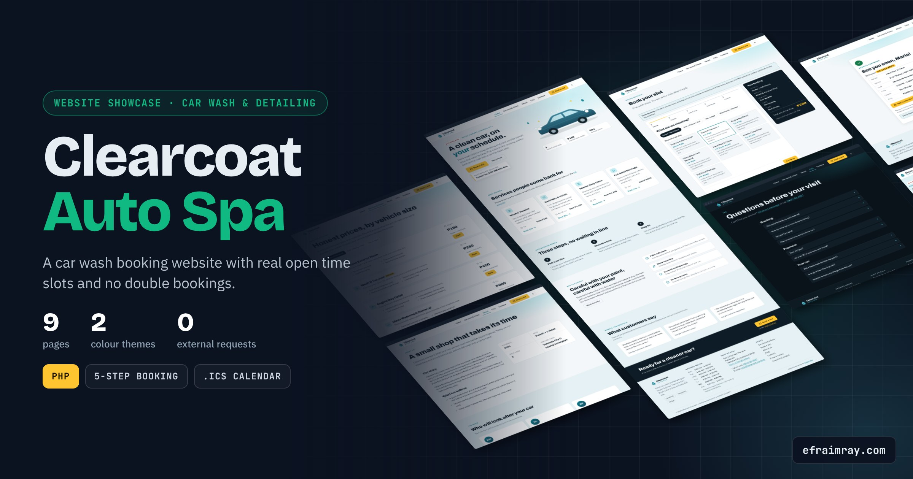
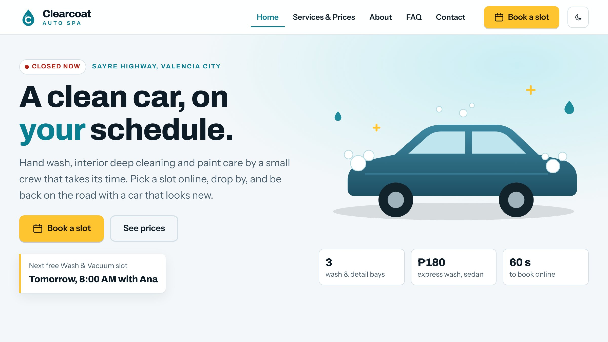
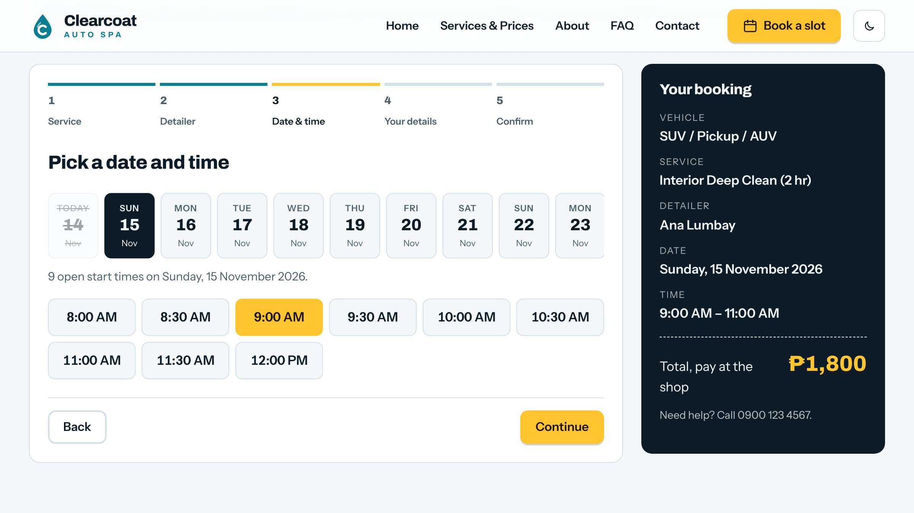
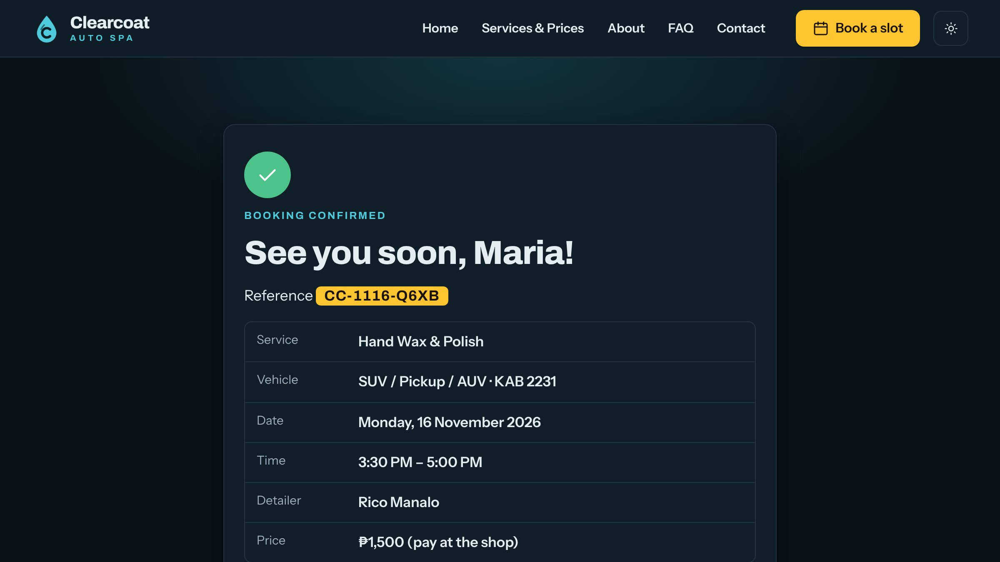
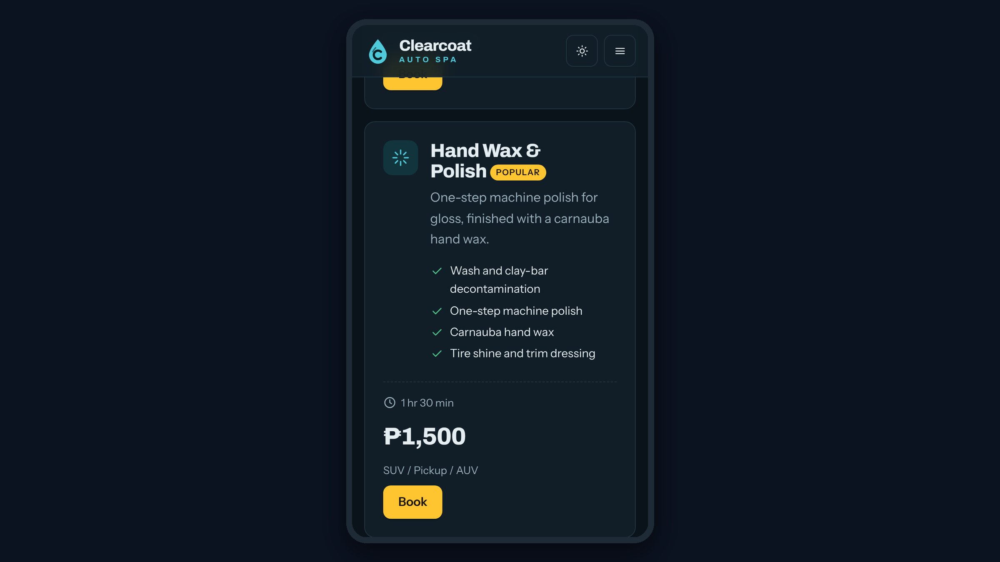

# Clearcoat Auto Spa

**A complete PHP booking website for a car wash and detailing shop: real open time slots, no double bookings, prices in pesos. No framework, no database.**

  -0a7f91)  



**Live demo:** https://efraimray.github.io/clearcoat-auto-spa/demo/ (static export; bookings are kept only in your browser)

> Clearcoat Auto Spa is a fictional business in Valencia City, Bukidnon, Philippines. Use this repository as a template for any local shop that takes appointments: car wash, salon, laundry pickup, tutorial center, photo studio.

New here? Read [docs/BUILD-LOG.md](docs/BUILD-LOG.md) for the languages used and how this was built.

## Screenshots


*Home page: the hero shows the next free Wash & Vacuum slot, worked out from the live schedule.*


*Booking wizard, step 3: date strip, open start times and the running summary with the price.*


*Confirmation page with the booking reference and the .ics calendar download.*


*Services & Prices at 390px in dark mode, with the vehicle-size price switcher.*

## Features

- **9 pages**: Home, Services & Prices, Book, Confirmation, About (team), FAQ, Contact, Privacy notice (RA 10173), 404. The demo adds an "About this project" page.
- **Five-step booking wizard**: vehicle and service, detailer (or "Any detailer"), date and time, your details, review and confirm.
- **Real slot engine**: business hours per weekday, holidays, staff working days and skills, service length, 30-minute steps, one-hour lead time, 21 days ahead.
- **No double booking**: the slot is checked again inside an exclusive file lock just before the booking is saved. Two people clicking the same time at once get one booking and one "just taken" message (tested).
- **Confirmation page** with a private link (reference + token) and an **.ics calendar file** with a one-hour reminder.
- **Prices by vehicle size** (sedan, SUV/pickup, van, motorcycle) with a live switcher; full price table.
- **Contact form** with CSRF token, honeypot, server-side validation, storage and optional e-mail.
- **Private storage**: bookings and messages are saved in `.php` files that start with `<?php exit; ?>`, so even a server without `.htaccess` support shows nothing.
- **Design**: light and dark themes, responsive down to 360px, mobile menu, sticky call/book buttons, skip link, focus states, reduced-motion support, inline SVG illustration.
- **SEO**: per-page titles and descriptions, Open Graph, AutoWash and FAQPage JSON-LD, sitemap.xml, robots.txt, SVG favicon.
- **Fast**: zero external requests (fonts are self-hosted), no framework, about 20 KB of gzipped CSS + JS.

## Tech Stack

| Part | Technology |
| --- | --- |
| Server | PHP 7.4+ (no framework), sessions for CSRF, `flock()` for safe writes |
| Data | JSON files: `data/services.json`, `data/staff.json`, `data/settings.json` |
| Front end | HTML5, CSS custom properties, vanilla JavaScript (ES5, no build) |
| Calendar | iCalendar (.ics, RFC 5545) generated in PHP (and in JS for the demo) |
| Fonts | Archivo + Instrument Sans (SIL OFL), self-hosted woff2 |

## Folder Structure

```
clearcoat-auto-spa/
├── index.php, services.php, book.php, confirmation.php, about.php,
│   faq.php, contact.php, privacy.php, 404.php   ← the pages
├── ics.php                 ← downloads a booking as a calendar file
├── api/slots.php           ← JSON: free start times for service + detailer + date
├── inc/
│   ├── bootstrap.php       ← loads everything, starts the session
│   ├── functions.php       ← escaping, links, CSRF, storage with file lock
│   ├── booking.php         ← THE slot engine + booking validation + .ics
│   ├── header.php / footer.php / icons.php
├── data/                   ← edit these to rebrand: services, staff, settings
├── storage/                ← bookings and messages are written here (keep private)
├── assets/css/style.css    ← design system (tokens, light/dark)
├── assets/js/main.js       ← menu, theme, price switcher, form validation
├── assets/js/engine.js     ← JavaScript twin of inc/booking.php
├── assets/js/booking.js    ← booking wizard UI
├── tools/export-static.php ← builds demo/ (static HTML for GitHub Pages)
├── tools/test-engine.php / test-engine.js ← tests
├── demo/                   ← generated static site (live demo)
├── docs/                   ← BUILD-LOG, TUTORIAL, DEPLOYMENT, screenshots
└── publish-to-github.bat / .ps1 ← one-click GitHub publisher (Windows)
```

## Quick Start

```bash
git clone https://github.com/EfraimRay/clearcoat-auto-spa.git
cd clearcoat-auto-spa
php -S localhost:8000
# open http://localhost:8000
```

No Composer, npm or database. PHP 7.4 or newer with the `json` extension (standard).

## Usage

1. Open **Book a slot**, pick a vehicle type and a service.
2. Pick a detailer or "Any detailer".
3. Pick a date; only open start times are shown.
4. Enter name and mobile number (Philippine format), agree to the privacy notice.
5. Confirm. The customer sees a reference like `CC-1107-K4TP` and can add the booking to their calendar.

Bookings are saved in `storage/bookings.php`. If `notify_email` is set in `data/settings.json`, the shop also gets an e-mail for each booking and message.

## Configuration

All settings are plain JSON:

| File | What to change |
| --- | --- |
| `data/settings.json` | business name, phone, e-mail, address, map link, social links, opening `hours` (0 = Sunday), `blocked_dates` (holidays), `slot_step`, `lead_minutes`, `days_ahead`, `notify_email`, `base_url`, `demo_busy` |
| `data/services.json` | services: id, name, minutes, prices per vehicle type, summary, includes, icon |
| `data/staff.json` | detailers: name, initials, role, working `days`, `services` they can do |

**Turn off the demo busy blocks** before going live: set `"demo_busy": false`. They only exist so the demo calendar never looks empty.

## Deployment

On Windows, double-click **publish-to-github.bat** to create the GitHub repository, release and live demo in one go. Full steps for GitHub, cPanel shared hosting, custom domains and e-mail are in [docs/DEPLOYMENT.md](docs/DEPLOYMENT.md).

After changing the PHP pages, rebuild the static demo with `php tools/export-static.php`.

## Customization (rebrand for a real client)

1. **Name and contact details**: `data/settings.json` → `business`.
2. **Colours**: the tokens at the top of `assets/css/style.css` (`--aqua`, `--signal`, `--ink`, and the dark-theme block). Keep the light and dark blocks in step.
3. **Logo**: `cc_logo()` in `inc/icons.php` (inline SVG) and `assets/img/favicon.svg`.
4. **Content**: page copy lives in each page file (`index.php`, `about.php`...). Replace the sample testimonials with real reviews and the fictional team with the real crew.
5. **Services, prices, staff, hours, holidays**: the three JSON files.
6. **Photos**: replace the SVG car with real photos of the shop if you have them (compress to WebP or JPG under 200 KB).
7. **Other niches**: rename "detailer" to "stylist" or "tutor", change `vehicles` to sizes or levels, and the same engine books salons, tutorials or laundry pickups.

## Testing

```bash
php tools/test-engine.php    # 20 checks: hours, holidays, staff, lead time, double booking, .ics
node tools/test-engine.js    # 13 checks: engine.js gives exactly the same slots as PHP
```

## Roadmap

- Admin page (password protected) to list, mark done and cancel bookings, with CSV export.
- SMS or Messenger reminder the day before.
- Customer self-cancel link on the confirmation page.
- SQLite storage option for busy shops.

## Contributing

Issues and pull requests are welcome. Keep it framework-free, run both test scripts and `php -l` on changed files, and rebuild `demo/`.

## Requesting improvements

Open an issue and add the label **`claude-improve`**. The nightly showcase run picks up open `claude-improve` issues, implements them, bumps the version and prepares a new release.

## License

MIT © 2026 Efraim Ray. Fonts: SIL Open Font License 1.1. Business, people and testimonials are fictional.

## Author

**Efraim Ray**, web developer and AI automation specialist in Valencia City, Bukidnon. https://www.efraimray.com/
